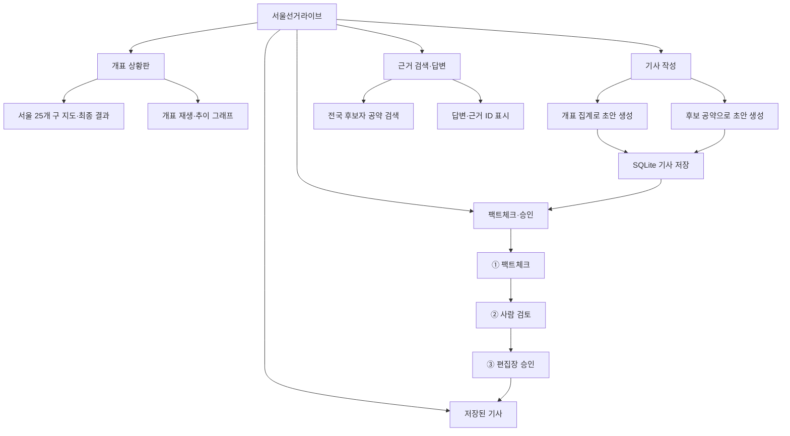
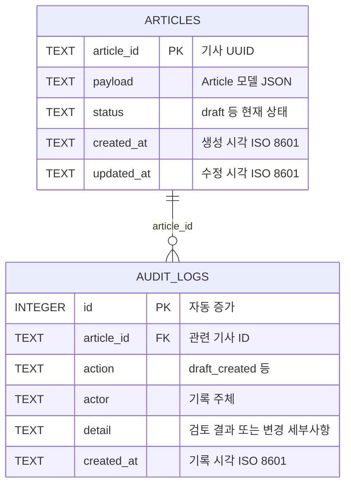

# 서울선거라이브 | 근거 기반 AI 선거 뉴스룸

2026년 제9회 전국동시지방선거 데이터를 활용해 **개표 상황 시각화 → 근거 검색(RAG) → 기사 초안 작성 → 팩트체크 → 사람 검토 → 편집장 승인**을 한 웹앱에서 시연하는 팀 프로젝트입니다.

> **구현 범위 안내:** 서울시장 선거 개표 재생 및 서울 25개 자치구 최종 결과 시각화와 전국 후보자 공약 검색을 결합했습니다. 개표 재생의 일부 중간 프레임은 **시연용 재구성**이며, 공약은 **후보자가 제출한 계획**으로 실제 이행 여부를 뜻하지 않습니다. 기사 최종 송고를 자동화하는 서비스가 아닙니다.

## 목차

1. [프로젝트 소개](#1-프로젝트-소개)
2. [기능정의서](#2-기능정의서)
3. [화면구성도](#3-화면구성도)
4. [DB 설계](#4-db-설계)
5. [데이터 수집 방법](#5-데이터-수집-방법)
6. [개발 환경](#6-개발-환경)
7. [실행 방법](#7-실행-방법)
8. [테스트 항목](#8-테스트-항목)

## 1. 프로젝트 소개

### 주제

선거 데이터 및 공식 공약 자료를 기사 작성의 **검증 가능한 근거**로 연결하는 AI 뉴스룸입니다. 사용자가 개표 수치를 확인하고 후보자의 공약을 검색한 뒤, 근거 ID가 포함된 기사 초안을 만들고 사람의 승인을 거치도록 설계했습니다.

### 주요 독자·사용자

| 대상 | 사용 목적 |
|---|---|
| 일반 독자 | 서울시장 개표 결과와 지역별 차이, 후보자 공약 확인 |
| 취재기자·기사 작성자 | 출처 검색, 근거 ID 확인, 기사 초안 작성·수정 |
| 검토자·편집장 | 팩트체크 결과 확인, 사람 검토, 최종 승인 및 이력 조회 |
| 프로젝트 평가자 | 데이터 출처, RAG 근거, 승인 차단 규칙 및 시연 확인 |

### 화면 이미지

실제 배포 화면의 캡처를 추가할 자리입니다. **아래 경로는 이미지 추가 전까지 플레이스홀더**입니다.

| 화면 | 이미지 삽입 위치 |
|---|---|
| 개표 상황판·서울 25개 구 지도 | `docs/images/election-dashboard.png` (예정) |
| 공약 RAG 검색·챗봇 | `docs/images/rag-chatbot.png` (예정) |
| 기사 작성·팩트체크·승인 | `docs/images/editorial-workflow.png` (예정) |

## 2. 기능정의서

| ID | 기능 | 입력 / 처리 | 출력·상태 |
|---|---|---|---|
| F01 | 개표 재생·상황판 | 저장된 서울시장 개표 프레임을 WebSocket으로 전달 | 진행률, 후보별 득표, 그래프 |
| F02 | 서울 25개 구 최종 결과 | 저장된 자치구별 개표 결과 사용 | 지도, 접전 지역 비교, 투표 방식별 결과 |
| F03 | 전국 후보자 공약 RAG 검색 | 검색어와 후보자명·지역을 이용한 로컬 키워드 검색 | 공약 원문, 출처 URL, `NEC-PRMS-...` 근거 ID |
| F04 | 근거 기반 AI 답변 | 검색된 근거 최대 5건을 답변 모델에 제공 | 한국어 답변과 실제 사용 근거 ID; API 키 없을 때 원문 반환 |
| F05 | 개표 기사 초안 | 개표 스냅샷 기반 템플릿 또는 선택적 OpenAI 생성 | 제목·본문·근거, 초안 저장 |
| F06 | 공약 기사 초안 | 후보자·지역 검색 후 동일 후보의 공약 원문 선택 | 공약 소개형 초안, 원문 발췌·근거 ID |
| F07 | 기사 수정·보관 | 제목·본문 수정, SQLite 저장 및 목록 조회 | 새로고침 뒤에도 저장 기사 재조회 가능 |
| F08 | 자동 팩트체크 | 개표 기사: 수치·후보·지역·시각·출처 / 공약 기사: 원본·후보·공약명·근거 ID | `pass` / `fail` / `review_required` |
| F09 | 단계별 검토·승인 | 팩트체크 통과 → 사람 검토 → 편집장 승인 | 상태 전이 강제 및 감사 로그 |
| F10 | 승인 후 외부 송고 연동 | 승인 상태와 CMS 설정 확인 | CMS 설정 시 전송; 재생 시연 기사는 외부 전송 차단 |

**구현상 주의점**

- 공약 검색은 **로컬 키워드·문자 2-gram 기반 RAG 검색**입니다. 벡터 DB나 임베딩 검색이 필수적으로 실행되는 구조는 아닙니다.
- 공약 기사 초안은 현재 **공약 목록·원문 발췌 형식**입니다. 뉴스 가치에 따른 쟁점 발굴과 분석형 기사 구성은 **개선 백로그**로 남아 있습니다.
- 공약 팩트체크는 등록 원문 및 연결된 근거가 일치하는지 확인합니다. 공약의 실현 가능성이나 실제 이행 여부를 판정하지 않습니다.
- 공개 배포에서 OpenAI 키가 설정되지 않았다면 챗봇은 검색 원문을 반환합니다. AI 생성 기능이 항상 활성화되는 것은 아닙니다.

## 3. 화면구성도



화면은 `static/index.html`, `static/app.js`, `static/final-results.js` 및 스타일 파일로 구성됩니다. 플로팅 RAG 챗봇에서도 근거 기반 질의응답을 이용할 수 있습니다.

### 주요 API

| 경로 | 역할 |
|---|---|
| `GET /health` | 서비스 상태와 외부 연동 설정 여부 확인 |
| `GET /api/replay`, `WS /ws/replay` | 서울시장 개표 재생 |
| `GET /api/count-timeline`, `WS /ws/count-timeline` | 보도 시각 기반 개표 타임라인 |
| `GET /api/rag/search?q=...` | 공약 및 근거 검색 |
| `GET /api/rag/answer?q=...` | 검색 근거에 기반한 답변 |
| `GET /api/rag/search?replay=true&q=...` | 재생 전용 근거 검색 |
| `POST /api/articles` | 개표 기사 초안 생성 |
| `POST /api/articles/from-pledges` | 공약 소개 기사 초안 생성 |
| `GET /api/articles`, `GET /api/articles/{article_id}` | 기사 목록·단건 조회 |
| `PUT /api/articles/{article_id}` | 기사 수정 |
| `POST /api/articles/{article_id}/fact-check` | 팩트체크 |
| `POST /api/articles/{article_id}/human-review` | 사람 검토 |
| `POST /api/articles/{article_id}/approve` | 편집장 승인 |
| `GET /api/articles/{article_id}/audit` | 감사 로그 |
| `POST /api/articles/{article_id}/publish` | 승인 기사 CMS 전송 시도(설정에 따름) |
| `GET /docs` | FastAPI 자동 API 문서 |

## 4. DB 설계

실행 시 **SQLite**에 `articles`와 `audit_logs` 테이블을 생성합니다. 후보자·공약 원본은 현재 **CSV / JSON / XML 파일**로 관리하며 별도 SQLite 테이블로 저장하지 않습니다.

### ERD (Mermaid)



> ERD는 **코드상의 논리적 관계**를 나타냅니다. `audit_logs.article_id`는 기사 ID를 참조하지만, SQLite `CREATE TABLE`에는 외래 키 제약이 선언되어 있지 않습니다.

### 기사 데이터 구조

`articles.payload`에는 다음 필드가 JSON으로 저장됩니다.

| 필드 | 의미 |
|---|---|
| `article_id` | 기사 식별자 |
| `article_type` | `election` 또는 `pledge` |
| `title`, `body` | 기사 제목·본문 |
| `status` | `draft` → `fact_checked` → `human_reviewed` → `approved` |
| `snapshot` | 개표 기사의 집계 정보; 공약 기사는 `null` |
| `evidence` | 근거 ID·제목·내용·출처 URL 등의 배열 |
| `created_at`, `updated_at` | 생성·최종 수정 시각 |

수정한 기사는 재검증을 위해 `draft`로 돌아갑니다. DB 구현: `app/services/storage_service.py`.

## 5. 데이터 수집 방법

### 5-1. 후보자·공약

중앙선거관리위원회 공공데이터포털 OpenAPI에서 2026년 6월 3일 지방선거 후보자 및 공약 정보를 수집했습니다.

| 자료 | 대상 및 방법 | 저장 형태 |
|---|---|---|
| 후보자 등록 정보 | 선관위 후보자 등록 API, 선거 종류 코드 `3`·`4`·`11` | 원본 XML, 전국 후보 CSV |
| 후보자 공약 | 선관위 공약 API, 후보자 식별자 기준 요청 | 원본 XML, 통합 JSON |
| 공약 RAG 문서 | 후보 CSV와 공약 JSON을 연결하여 후보명·지역·공약별 근거 ID 부여 | 서버 시작 시 로컬 검색 색인 |

- 선거 종류: `3` 광역단체장, `4` 기초단체장, `11` 교육감
- 수집 후보: **697명**. 공약 API 응답은 **666명**, 이후 원본 XML을 이용한 본문 복구는 **665명·3,325개 본문** 기준으로 확인했습니다. 공약 데이터 미제공·오류가 있는 후보는 별도로 남아 있습니다.
- 공약 본문 XML 필드는 `prmmCont1` ~ `prmmCont10`입니다. 최초 필드명 불일치로 누락된 내용을 **보존된 원본 XML에서 복구**했습니다.
- 후보가 제출한 공약과 실행 완료 정책은 구분해야 하며, 해당 공약 정보를 선관위가 사실관계까지 검증했다는 뜻이 아닙니다.

주요 파일:
- `data/processed/candidates_20260603_all_3-4-11.csv`
- `data/processed/pledges/pledges_20260603_all_3-4-11.json`
- `data/raw/candidates/api/`, `data/raw/pledges/api/`
- `app/services/pledge_documents.py`, `app/services/rag_service.py`

출처: [중앙선관위 공약 OpenAPI](https://www.data.go.kr/data/15040587/openapi.do), [공공데이터포털](https://www.data.go.kr/).

### 5-2. 개표 결과 및 시연 데이터

서울시장 개표 보도 집계와 서울 25개 구 최종 개표 자료를 별도 파일로 관리합니다.

- `data/replay/reported_results.csv`: 연합뉴스가 보도한 99.54%, 100% 시점의 서울시장 후보별 집계
- `data/replay/count_timeline.csv`: 상황판 재생과 기사 초안에 공통으로 사용하는 15단계 개표 타임라인. 집계가 없는 단계에서는 해당 사건 초안을 작성합니다.
- `data/replay/snapshots.json`: 기존 재생 API 호환용 12단계 스냅샷
- `data/replay/rag_documents.json`: 개표 보도 근거 및 재생 자료 설명

출처: [중앙선관위 개표결과 CSV 안내](https://www.data.go.kr/data/15162288/fileData.do), [연합뉴스 99.54% 집계](https://www.yna.co.kr/amp/view/AKR20260604181600004), [연합뉴스 최종 집계](https://www.yna.co.kr/amp/view/AKR20260605106300004).

**실제 보도값과 재구성값을 혼동하지 않도록** 화면 및 기사에서 구분합니다. 자치구 지도는 저장된 최종 결과 데이터를 시각화하며, WebSocket 재생이 실시간 선관위 개표 스트림을 의미하지는 않습니다.

## 6. 개발 환경

| 구분 | 기술 |
|---|---|
| 언어·런타임 | Python 3.14(로컬 개발), JavaScript, HTML, CSS |
| 백엔드 | FastAPI, Uvicorn |
| 데이터 모델 | Pydantic, pydantic-settings |
| 저장소 | SQLite |
| HTTP 클라이언트 | httpx |
| RAG | 로컬 키워드·문자 2-gram 검색, 근거 ID 인용 |
| 생성형 AI | OpenAI Chat Completions(키 설정 시) |
| 실시간 전송 | WebSocket |
| 테스트 | pytest, FastAPI TestClient |
| 버전 관리·협업 | Git, GitHub, VS Code |
| 공개 시연 배포 | Railway, 영구 저장용 Volume |

의존성 버전은 `requirements.txt`를 기준으로 관리합니다. 환경변수는 `app/config.py`에서 읽으며 비밀 키는 Git에 커밋하지 않습니다.

## 7. 실행 방법

### 7-1. 로컬 실행 (Windows PowerShell)

프로젝트 루트에서 다음 명령을 실행합니다.

```powershell
py -3.14 -m venv .venv
.\.venv\Scripts\python.exe -m pip install -r requirements.txt
.\.venv\Scripts\python.exe -m uvicorn app.main:app --host 127.0.0.1 --port 8000
```

- 웹앱: <http://127.0.0.1:8000>
- API 문서: <http://127.0.0.1:8000/docs>
- 헬스 체크: <http://127.0.0.1:8000/health>

`run.py`는 개발용 `reload=True`로 실행됩니다. 프로젝트 내부의 가상환경 파일 변경 때문에 재시작이 반복될 수 있어 위 명령처럼 **자동 재시작 없이 실행**하는 방법을 권장합니다.

선택적으로 프로젝트 루트에 `.env` 파일을 만들어 `OPENAI_API_KEY`를 입력할 수 있습니다. 미설정 시 AI 문장 생성 대신 검색된 원문 근거가 표시됩니다.

### 7-2. 공개 배포 (Railway)

GitHub 저장소를 Railway 서비스에 연결합니다.

| 설정 | 값·설명 |
|---|---|
| Start Command | `uvicorn app.main:app --host 0.0.0.0 --port ${PORT:-8000}` |
| `DATABASE_URL` | `sqlite:////data/election_newsroom.db` |
| Volume Mount Path | `/data` |
| `OPENAI_API_KEY` | 필요할 때만 Railway Variables에 등록 |
| `APP_MODE` | 현재 시연은 `demo`; `production` 사용 시 아래 쓰기 토큰 조건 확인 |
| `NEWSROOM_WRITE_TOKEN` | 선택적 팀 쓰기 토큰. `production` 모드에서 미설정하면 기사 쓰기 API는 503으로 차단됨 |

공개 시연에서 토큰을 사용하지 않으면 외부에서 기사 변경 API를 호출할 수 있으므로 **민감한 원고나 개인정보를 저장하지 마세요**. 공개 배포는 실제 선거 관제 서비스가 아니라 **교육용 시연**입니다.

### 7-3. 사용 흐름

1. **개표 상황판:** 서울시장 개표 재생과 자치구별 결과 확인
2. **근거 검색·답변:** 예시 질문 `2026년 서울시장 정원오 후보의 공약을 모두 알려줘`
3. **기사 작성:** 개표 집계 또는 후보자 공약으로 초안 생성
4. **팩트체크·승인:** 자동 검증 → 검토자 입력 → 편집장 승인
5. **저장된 기사:** 목록에서 기사 다시 선택, 편집 이력 조회

기사는 SQLite에 저장되므로 **브라우저 새로고침 후에도 목록에서 재조회**할 수 있습니다. 다만 새로고침 후 마지막으로 열었던 기사를 자동 선택하는 기능은 아직 없습니다.

## 8. 테스트 항목

### 자동 테스트

```powershell
.\.venv\Scripts\python.exe -m pytest -q
```

주요 테스트는 다음과 같습니다.

| 테스트 파일 | 검증 내용 |
|---|---|
| `tests/test_replay.py` | 개표 재생 순서·집계 원본 대조, 변조 데이터 차단, 승인 순서, 재생 기사 외부 전송 차단 |
| `tests/test_workflow.py` | 기사 저장, 팩트체크 → 사람 검토 → 편집장 승인, 감사 로그, 승인 전 송고 차단 |
| `tests/test_pledge_rag.py` | 후보자명·지역 조건 검색, 공약 근거 ID, 재생 RAG 색인 분리 |
| `tests/test_pledge_article.py` | 공약 기사 생성·DB 조회·승인, 미존재 후보 차단, 공약 제목 변조 감지 |

**확인된 실행 결과:** 개발 중 `tests/test_pledge_rag.py` 2건, 승인 흐름 및 재생 기사 테스트가 통과했습니다. 전체 테스트 스위트의 최신 일괄 통과 여부는 별도 확인이 필요합니다.

### 수동 시연 체크

- [x] Railway 공개 주소에서 개표 상황판 표시
- [x] 전국 공약 RAG 챗봇 질문 및 근거 확인
- [x] 공개 웹앱에서 공약 기사 생성 UI 확인
- [x] SQLite에 기사 저장 및 API·화면에서 재조회
- [ ] 공개 서버에서 팩트체크 → 사람 검토 → 편집장 승인 전체 흐름 확인
- [ ] Railway 재배포 이후 동일 기사 유지 확인 (현재 추가 검증 생략)

### 남은 개선 백로그

- 공약 5건 단순 나열이 아닌 **쟁점 중심 기사 발굴·분석형 기사 초안** 개선
- 브라우저 새로고침 이후 마지막으로 열었던 기사 자동 선택
- 외부 공개 시연에서 쓰기 권한 및 원고 조회 범위 운영 정책 정리

---

**이 프로젝트의 핵심은 AI가 기사를 무조건 발행하는 것이 아니라, 출처와 근거를 남기고 사람이 최종 승인하는 뉴스룸 흐름을 시연하는 데 있습니다.**
